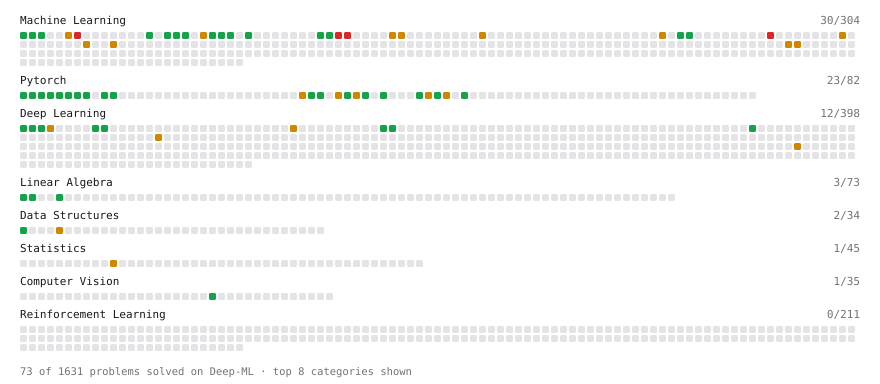

# Deep-ML

My machine learning practice from [Deep-ML](https://www.deep-ml.com). Every solution here was written by hand.

**91** solved · 70 problems · 4 labs · 17 math

[**Browse the interactive portfolio**](https://Istiaaak.github.io/deep-ml/) to replay this filling in over time.

## Problems

| | Difficulty | Solved | |
| --- | --- | --- | --- |
| [Adagrad Optimizer](https://www.deep-ml.com/problems/145) | easy | 2026-10-20 | [solution](problems/0145-adagrad-optimizer) |
| [Add a Bias Vector to a Batch via Broadcasting](https://www.deep-ml.com/problems/882) | easy | 2026-09-21 | [solution](problems/0882-add-a-bias-vector-to-a-batch-via-broadcasting) |
| [Backprop a Linear Layer by Hand](https://www.deep-ml.com/problems/898) | easy | 2026-10-19 | [solution](problems/0898-backprop-a-linear-layer-by-hand) |
| [Batch a TensorDataset with DataLoader](https://www.deep-ml.com/problems/1237) | easy | 2026-10-20 | [solution](problems/1237-batch-a-tensordataset-with-dataloader) |
| [Binary Classification with Logistic Regression](https://www.deep-ml.com/problems/104) | easy | 2026-09-18 | [solution](problems/0104-binary-classification-with-logistic-regression) |
| [Build a Dataset and Use It with a DataLoader](https://www.deep-ml.com/problems/899) | easy | 2026-10-20 | [solution](problems/0899-build-a-dataset-and-use-it-with-a-dataloader) |
| [Build a Linear Regression Model with nn.Module](https://www.deep-ml.com/problems/885) | easy | 2026-10-20 | [solution](problems/0885-build-a-linear-regression-model-with-nn-module) |
| [Build an MLP with nn.Sequential](https://www.deep-ml.com/problems/887) | easy | 2026-10-20 | [solution](problems/0887-build-an-mlp-with-nn-sequential) |
| [Calculate Accuracy Score](https://www.deep-ml.com/problems/36) | easy | 2026-09-18 | [solution](problems/0036-calculate-accuracy-score) |
| [Calculate Mean Absolute Error (MAE)](https://www.deep-ml.com/problems/93) | easy | 2026-09-17 | [solution](problems/0093-calculate-mean-absolute-error-mae) |
| [Calculate Root Mean Square Error (RMSE)](https://www.deep-ml.com/problems/71) | easy | 2026-09-17 | [solution](problems/0071-calculate-root-mean-square-error-rmse) |
| [Calculate SVM Margin Width](https://www.deep-ml.com/problems/282) | easy | 2026-09-25 | [solution](problems/0282-calculate-svm-margin-width) |
| [Compute a Gradient with PyTorch Autograd](https://www.deep-ml.com/problems/884) | easy | 2026-09-22 | [solution](problems/0884-compute-a-gradient-with-pytorch-autograd) |
| [Conv2d Output Shape](https://www.deep-ml.com/problems/1232) | easy | 2026-10-20 | [solution](problems/1232-conv2d-output-shape) |
| [Create a Float Tensor from a Python List](https://www.deep-ml.com/problems/880) | easy | 2026-09-21 | [solution](problems/0880-create-a-float-tensor-from-a-python-list) |
| [Create and Inspect a Tensor](https://www.deep-ml.com/problems/1220) | easy | 2026-10-19 | [solution](problems/1220-create-and-inspect-a-tensor) |
| [Feature Scaling Implementation](https://www.deep-ml.com/problems/16) | easy | 2026-09-16 | [solution](problems/0016-feature-scaling-implementation) |
| [Implement a Linear Layer Forward Pass with Matrix Multiplication](https://www.deep-ml.com/problems/883) | easy | 2026-09-21 | [solution](problems/0883-implement-a-linear-layer-forward-pass-with-matrix-multiplication) |
| [Implement F-Score Calculation for Binary Classification](https://www.deep-ml.com/problems/61) | easy | 2026-09-18 | [solution](problems/0061-implement-f-score-calculation-for-binary-classification) |
| [Implement Gini Impurity Calculation for a Set of Classes](https://www.deep-ml.com/problems/64) | easy | 2026-09-19 | [solution](problems/0064-implement-gini-impurity-calculation-for-a-set-of-classes) |
| [Implement Gradient Clipping by Value](https://www.deep-ml.com/problems/292) | easy | 2026-10-20 | [solution](problems/0292-implement-gradient-clipping-by-value) |
| [Implement Hinge Loss for SVM](https://www.deep-ml.com/problems/283) | easy | 2026-09-25 | [solution](problems/0283-implement-hinge-loss-for-svm) |
| [Implement Precision Metric](https://www.deep-ml.com/problems/46) | easy | 2026-09-18 | [solution](problems/0046-implement-precision-metric) |
| [Implement Recall Metric in Binary Classification](https://www.deep-ml.com/problems/52) | easy | 2026-09-18 | [solution](problems/0052-implement-recall-metric-in-binary-classification) |
| [Implement ReLU Activation Function](https://www.deep-ml.com/problems/42) | easy | 2026-09-21 | [solution](problems/0042-implement-relu-activation-function) |
| [Implement ReLU and Leaky ReLU](https://www.deep-ml.com/problems/1226) | easy | 2026-09-30 | [solution](problems/1226-implement-relu-and-leaky-relu) |
| [Implement Ridge Regression Loss Function](https://www.deep-ml.com/problems/43) | easy | 2026-09-18 | [solution](problems/0043-implement-ridge-regression-loss-function) |
| [Implement Weight Decay as L2 Regularization](https://www.deep-ml.com/problems/198) | easy | 2026-09-29 | [solution](problems/0198-implement-weight-decay-as-l2-regularization) |
| [Leaky ReLU Activation Function](https://www.deep-ml.com/problems/44) | easy | 2026-09-21 | [solution](problems/0044-leaky-relu-activation-function) |
| [Linear Kernel Function](https://www.deep-ml.com/problems/45) | easy | 2026-09-25 | [solution](problems/0045-linear-kernel-function) |
| [Linear Regression Using Gradient Descent](https://www.deep-ml.com/problems/15) | easy | 2026-09-17 | [solution](problems/0015-linear-regression-using-gradient-descent) |
| [Linear Regression Using Normal Equation](https://www.deep-ml.com/problems/14) | easy | 2026-09-17 | [solution](problems/0014-linear-regression-using-normal-equation) |
| [Matrix-Vector Dot Product](https://www.deep-ml.com/problems/1) | easy | 2026-09-03 | [solution](problems/0001-matrix-vector-dot-product) |
| [Mean Squared Error from Scratch](https://www.deep-ml.com/problems/1228) | easy | 2026-09-30 | [solution](problems/1228-mean-squared-error-from-scratch) |
| [Min-Max Scaling of Feature Values](https://www.deep-ml.com/problems/112) | easy | 2026-09-03 | [solution](problems/0112-min-max-scaling-of-feature-values) |
| [Momentum Optimizer](https://www.deep-ml.com/problems/146) | easy | 2026-10-20 | [solution](problems/0146-momentum-optimizer) |
| [One SGD Update Step](https://www.deep-ml.com/problems/1234) | easy | 2026-10-20 | [solution](problems/1234-one-sgd-update-step) |
| [Reshape and Transpose a Tensor](https://www.deep-ml.com/problems/881) | easy | 2026-09-21 | [solution](problems/0881-reshape-and-transpose-a-tensor) |
| [Reshape and Transpose a Tensor](https://www.deep-ml.com/problems/1221) | easy | 2026-10-19 | [solution](problems/1221-reshape-and-transpose-a-tensor) |
| [Run One Training Step: Forward, Loss, Backward, Optimizer](https://www.deep-ml.com/problems/886) | easy | 2026-10-20 | [solution](problems/0886-run-one-training-step-forward-loss-backward-optimizer) |
| [Scalar Multiplication of a Matrix](https://www.deep-ml.com/problems/5) | easy | 2026-09-03 | [solution](problems/0005-scalar-multiplication-of-a-matrix) |
| [Sigmoid Activation Function Understanding](https://www.deep-ml.com/problems/22) | easy | 2026-09-21 | [solution](problems/0022-sigmoid-activation-function-understanding) |
| [Single Linear Neuron Forward](https://www.deep-ml.com/problems/1224) | easy | 2026-09-22 | [solution](problems/1224-single-linear-neuron-forward) |
| [Single Neuron](https://www.deep-ml.com/problems/24) | easy | 2026-10-03 | [solution](problems/0024-single-neuron) |
| [Softmax Activation Function Implementation ](https://www.deep-ml.com/problems/23) | easy | 2026-09-21 | [solution](problems/0023-softmax-activation-function-implementation) |
| [Transpose of a Matrix](https://www.deep-ml.com/problems/2) | easy | 2026-09-03 | [solution](problems/0002-transpose-of-a-matrix) |
| [Apply a 2D Convolution](https://www.deep-ml.com/problems/1233) | medium | 2026-10-20 | [solution](problems/1233-apply-a-2d-convolution) |
| [Calculate Explained Variance Ratio for PCA](https://www.deep-ml.com/problems/350) | medium | 2026-09-24 | [solution](problems/0350-calculate-explained-variance-ratio-for-pca) |
| [Elastic Net Regression via Gradient Descent](https://www.deep-ml.com/problems/139) | medium | 2026-09-29 | [solution](problems/0139-elastic-net-regression-via-gradient-descent) |
| [Find the Best Gini-Based Split for a Binary Decision Tree](https://www.deep-ml.com/problems/138) | medium | 2026-09-23 | [solution](problems/0138-find-the-best-gini-based-split-for-a-binary-decision-tree) |
| [Gradient of a Weighted Sum of Squares](https://www.deep-ml.com/problems/1223) | medium | 2026-10-19 | [solution](problems/1223-gradient-of-a-weighted-sum-of-squares) |
| [Handle Imbalanced Data with SMOTE](https://www.deep-ml.com/problems/357) | medium | 2026-09-25 | [solution](problems/0357-handle-imbalanced-data-with-smote) |
| [Implement Batch Normalization for BCHW Input](https://www.deep-ml.com/problems/115) | medium | 2026-10-20 | [solution](problems/0115-implement-batch-normalization-for-bchw-input) |
| [Implement K-Nearest Neighbors](https://www.deep-ml.com/problems/173) | medium | 2026-09-20 | [solution](problems/0173-implement-k-nearest-neighbors) |
| [Implement Lasso Regression using ISTA](https://www.deep-ml.com/problems/50) | medium | 2026-09-18 | [solution](problems/0050-implement-lasso-regression-using-ista) |
| [Implement RBF (Gaussian) Kernel Function](https://www.deep-ml.com/problems/280) | medium | 2026-09-25 | [solution](problems/0280-implement-rbf-gaussian-kernel-function) |
| [Learning Curve Generator for Bias-Variance Diagnosis](https://www.deep-ml.com/problems/800) | medium | 2026-09-19 | [solution](problems/0800-learning-curve-generator-for-bias-variance-diagnosis) |
| [Maximum A Posteriori (MAP) Estimation for Bernoulli Parameter](https://www.deep-ml.com/problems/338) | medium | 2026-09-20 | [solution](problems/0338-maximum-a-posteriori-map-estimation-for-bernoulli-parameter) |
| [Maximum Likelihood Estimation for Gaussian Distribution](https://www.deep-ml.com/problems/337) | medium | 2026-09-20 | [solution](problems/0337-maximum-likelihood-estimation-for-gaussian-distribution) |
| [One Training Step](https://www.deep-ml.com/problems/1219) | medium | 2026-10-20 | [solution](problems/1219-one-training-step) |
| [Polynomial Regression Fit](https://www.deep-ml.com/problems/801) | medium | 2026-09-29 | [solution](problems/0801-polynomial-regression-fit) |
| [Principal Component Analysis (PCA) Implementation](https://www.deep-ml.com/problems/19) | medium | 2026-09-24 | [solution](problems/0019-principal-component-analysis-pca-implementation) |
| [Reconstruction Error from PCA](https://www.deep-ml.com/problems/353) | medium | 2026-09-24 | [solution](problems/0353-reconstruction-error-from-pca) |
| [SGD with Momentum Step](https://www.deep-ml.com/problems/1235) | medium | 2026-10-20 | [solution](problems/1235-sgd-with-momentum-step) |
| [Single Neuron with Backpropagation](https://www.deep-ml.com/problems/25) | medium | 2026-10-03 | [solution](problems/0025-single-neuron-with-backpropagation) |
| [Two-Layer MLP Forward Pass](https://www.deep-ml.com/problems/1225) | medium | 2026-09-30 | [solution](problems/1225-two-layer-mlp-forward-pass) |
| [Decision Tree Learning](https://www.deep-ml.com/problems/20) | hard | 2026-09-23 | [solution](problems/0020-decision-tree-learning) |
| [Implement Bagging Classifier from Scratch](https://www.deep-ml.com/problems/307) | hard | 2026-09-30 | [solution](problems/0307-implement-bagging-classifier-from-scratch) |
| [Train Logistic Regression with Gradient Descent](https://www.deep-ml.com/problems/106) | hard | 2026-09-18 | [solution](problems/0106-train-logistic-regression-with-gradient-descent) |
| [Train Softmax Regression with Gradient Descent](https://www.deep-ml.com/problems/105) | hard | 2026-09-25 | [solution](problems/0105-train-softmax-regression-with-gradient-descent) |

## Labs

| | Difficulty | Solved | |
| --- | --- | --- | --- |
| [PyTorch: Build a Complete Training Loop](https://www.deep-ml.com/labs/13) | easy | 2026-10-20 | [solution](labs/0013-pytorch-build-a-complete-training-loop) |
| [Train a Linear Regression Model](https://www.deep-ml.com/labs/18) | easy | 2026-09-17 | [solution](labs/0018-train-a-linear-regression-model) |
| [Fix Overfitting with Regularization (NumPy)](https://www.deep-ml.com/labs/21) | medium | 2026-09-25 | [solution](labs/0021-fix-overfitting-with-regularization-numpy) |
| [PyTorch: Implement Your Own Gradient Descent Training Step](https://www.deep-ml.com/labs/12) | medium | 2026-10-20 | [solution](labs/0012-pytorch-implement-your-own-gradient-descent-training-step) |

## Math

| | Difficulty | Solved | |
| --- | --- | --- | --- |
| [Class Imbalance and Proper Scoring](https://www.deep-ml.com/math-problems/44) | easy | 2026-09-25 | [solution](math/0044-class-imbalance-and-proper-scoring) |
| [Derivatives and Gradients](https://www.deep-ml.com/math-problems/1) | easy | 2026-09-16 | [solution](math/0001-derivatives-and-gradients) |
| [Descriptive Statistics](https://www.deep-ml.com/math-problems/18) | easy | 2026-09-16 | [solution](math/0018-descriptive-statistics) |
| [Expectation and Variance Algebra](https://www.deep-ml.com/math-problems/33) | easy | 2026-09-16 | [solution](math/0033-expectation-and-variance-algebra) |
| [Gradient Descent Updates](https://www.deep-ml.com/math-problems/5) | easy | 2026-09-16 | [solution](math/0005-gradient-descent-updates) |
| [ML Workflow Basics](https://www.deep-ml.com/math-problems/30) | easy | 2026-09-03 | [solution](math/0030-ml-workflow-basics) |
| [Vector Operations](https://www.deep-ml.com/math-problems/7) | easy | 2026-09-03 | [solution](math/0007-vector-operations) |
| [Backpropagation and the Chain Rule](https://www.deep-ml.com/math-problems/4) | medium | 2026-10-03 | [solution](math/0004-backpropagation-and-the-chain-rule) |
| [Covariance and Correlation](https://www.deep-ml.com/math-problems/17) | medium | 2026-09-18 | [solution](math/0017-covariance-and-correlation) |
| [Least Squares and the Normal Equations](https://www.deep-ml.com/math-problems/34) | medium | 2026-09-16 | [solution](math/0034-least-squares-and-the-normal-equations) |
| [Margins and Soft-Margin SVMs](https://www.deep-ml.com/math-problems/42) | medium | 2026-09-25 | [solution](math/0042-margins-and-soft-margin-svms) |
| [Matrix Calculus Identities](https://www.deep-ml.com/math-problems/35) | medium | 2026-10-03 | [solution](math/0035-matrix-calculus-identities) |
| [Neural Network Derivatives](https://www.deep-ml.com/math-problems/3) | medium | 2026-10-03 | [solution](math/0003-neural-network-derivatives) |
| [Regularization and Generalization](https://www.deep-ml.com/math-problems/31) | medium | 2026-09-16 | [solution](math/0031-regularization-and-generalization) |
| [Training Error, Test Error and the Bayes Rate](https://www.deep-ml.com/math-problems/104) | medium | 2026-09-17 | [solution](math/0104-training-error-test-error-and-the-bayes-rate) |
| [Vector Norms and Linear Independence](https://www.deep-ml.com/math-problems/8) | medium | 2026-09-03 | [solution](math/0008-vector-norms-and-linear-independence) |
| [Eigendecomposition and SVD](https://www.deep-ml.com/math-problems/16) | hard | 2026-09-18 | [solution](math/0016-eigendecomposition-and-svd) |

---

_This file is regenerated by Deep-ML on every push._
